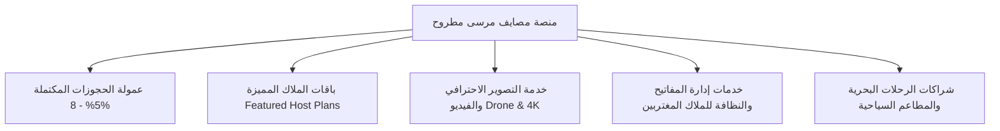

# دراسة وخطة العمل التشغيلية لمنصة شقق وشاليهات مرسى مطروح
# Comprehensive Business Plan: Marsa Matrouh Flats & Chalets Platform
## شعار المنصة: "عاين على الطبيعة قبل ما تدفع — صيفك في مطروح بأمان 100%"

---

## 1. الملخص التنفيذي (Executive Summary)

تعتبر مدينة **مرسى مطروح** الوجهة المصيفية الأولى لملايين العائلات المصرية والعربية بفضل شواطئها الفيروزية ذات الرمال البيضاء النقية (عجيبة، الأبيض، كليوباترا، الغرام، روميل، بو سيت). ورغم الإقبال الهائل سنوياً (أكثر من 5 ملايين زائر صيفاً)، إلا أن سوق تأجير الشقق المصيفية يعاني من فوضى عارمة وانعدام الثقة بسبب السماسرة غير الموثوقين، وعمليات الاحتيال، والصور المضللة.

يقدم هذا المشروع منصة رقمية متكاملة تعيد هندسة تجربة تأجير شقق مطروح من خلال ميزة تنافسية فريدة وحاسمة:
> **"كل شقة موثقة بسعر دقيق، ووصف تفصيلي، وألبوم صور وفيديو جولة حقيقية، مع إمكانية حجز الشقة ومقابلة المالك ومعاينتها على الطبيعة قبل دفع باقي المبلغ."**

---

## 2. المشكلات الحالية في السوق والحل المبتكر

| المشكلة في السوق التقليدي | الحل المبتكر عبر منصتنا |
| :--- | :--- |
| **الصور القديمة أو المعدلة (Catfishing)**: المستأجر يصل فيجد الشقة مختلفة تماماً عن الصور أو بدون إطلالة بحر حقيقية. | **فيديو جولة تفاعلية (Video Walkthrough)** يصور مدخل العمارة، المصعد، الصالة، الغرف، والإطلالة الحقيقية من الشرفة بتوثيق تاريخ التصوير. |
| **النصب في العربون (Advance Deposit Scams)**: سماسرة يطلبون تحويل مبالغ عبر المحافظ الإلكترونية ثم يختفون. | **ضمان المعاينة قبل الدفع الكامل**: لا يدفع المستأجر قيمة الإقامة إلا بعد مقابلة المالك ومعاينة الشقة واستلام المفتاح. |
| **عدم وضوح المسافة للشاطئ**: سمسار يقول "أول نمرة" وتكون الشقة في شارع خلفي بعيد. | **تحديد دقيق للمسافة بالمتر** وتصنيف الشواطئ (عجيبة، الأبيض، كليوباترا، الغرام، روميل) مع مميزات الشاطئ وطبيعته. |
| **تضييع وقت المالك والمستأجر**: نزول المستأجر للشارع للبحث بين مئات السماسرة تحت حرارة الشمس. | **نظام جدولة مواعيد معاينة مسبقة (Scheduled Inspection Slot)**: العميل يحدد ميعاد وصوله والمالك يكون في انتظاره. |

---

## 3. نماذج وسيناريوهات المعاينة والحجز (Coverage of All Use Cases)

تغطي المنصة جميع الحالات العملية للمصطافين والملاك بدقة:

### السيناريو الأول: عميل قادم من المحافظات ويريد المعاينة فور وصوله (Meet on Arrival)
1. يختار العميل الشقة وتواريخ الإقامة، ويشاهد الصور وفيديو الجولة.
2. يختار خيار **"طلب موعد معاينة مع المالك قبل الدفع"**.
3. يدخل العميل وقت وصوله المتوقع إلى مطروح (مثلاً: 12 ظهراً يوم السبت).
4. ترسل المنصة إشعاراً للمالك برقم هاتف العميل وموعد اللقاء عند مدخل العمارة.
5. يصل العميل، يقابل المالك، يعاين الشقة والتكييفات والنظافة:
   - **في حال الإعجاب**: يسدد المبلغ مباشرة للمالك ويستلم المفتاح ويبدأ إجازته.
   - **في حال وجود اختلاف جوهري**: يتم إلغاء الحجز فوراً بدون أي التزام مالي.

### السيناريو الثاني: عميل متواجد بالفعل في مرسى مطروح ويريد معاينة فورية (Same-Day Viewing)
- يمكن للعميل البحث عن الشقق في محيطه الجغرافي القريب، وطلب معاينة خلال 30 إلى 60 دقيقة عبر الضغط المباشر على زر "واتساب المالك للمعاينة الفورية".

### السيناريو الثالث: حجز الذروة الصيفية (يوليو / أغسطس) مع ضمان الحفظ (Token Holding)
- في أوقات الذروة يخشى المالك إلغاء العميل، ويخشى العميل ضياع الشقة:
  - المنصة توفر خيار "عربون جدية رمزي" (مثلاً 10% أو سعر ليلة واحدة) يحفظ بأمان في محفظة المنصة (Escrow).
  - لا يتم تحويل العربون للمالك إلا بعد إتمام المعاينة وموافقة العميل.
  - إذا وجد العميل الشقة غير مطابقة للفيديو والصور، يسترد عربونه بالكامل وتوفر له المنصة شقة بديلة فوراً.

### السيناريو الرابع: حالة الرفض عند المعاينة (Dispute & Inspection Rejection Protocol)
- إذا رفض العميل الشقة لأسباب مقنعة (عطل في التكييف، عدم نظافة، اختلاف الإطلالة):
  - المنصة لا تفرض أي رسوم.
  - نظام الاقتراحات الذكي بالمنصة يعرض على العميل فوراً 3 شقق بديلة في نفس المنطقة والأسعار مع إمكانية المعاينة السريعة.

---

## 4. نموذج العمل والإيرادات (Monetization & Revenue Streams)

تعتمد المنصة على مصادر دخل متنوعة ومربحة:

1. **عمولة من الحجز الناجح (Success Fee)**:
   - 5% إلى 8% تُخصم من المالك عند إتمام الحجز ورضا العميل (مجاناً تماماً للمستأجر لزيادة الإقبال).
2. **باقة المالك المميز (Featured Listings Subscription)**:
   - باقة شهرية أو موسمية للملاك تمنح شققهم ظهوراً في أعلى نتائج البحث مع شارة "شقة موثقة ومعاينة مضمونة".
3. **خدمة التصوير الفندقي والفيديو الميداني (Media Verification Pack)**:
   - يذهب مندوب المنصة في مطروح للشقة لتصوير ألبوم صور احترافي + فيديو 4K + توثيق مواصفات الشقة بمقابل مالي رمزي (مثلاً 500 ج.م تدفع لمرة واحدة).
4. **خدمة إدارة تسليم الشقق (Key Handover & Property Management)**:
   - خدمة موجهة للملاك المقيمين خارج مطروح (القاهرة، الإسكندرية، طنطا، المنصورة)، حيث يتولى مندوب المنصة مقابلة النزيل، عمل المعاينة، تسليم المفتاح، وتحصيل المبلغ وتحويله للمالك.
5. **خدمات المصيف التكميلية (Ancillary Partnerships)**:
   - شراكات مع رحلات اللنشات واليخوت في شاطئ الغرام والفيروز.
   - عروض خصم مع كبرى مطاعم الأسماك والمأكولات البدوية في مطروح.

---

## 5. ميزات تجربة المستخدم داخل التطبيق (App Features Architecture)

1. **بطاقة الشقة الغنية (Rich Flat Card)**:
   - شارة واضحة: `معاينة قبل الدفع متاحة ✅`.
   - شارة: `يوجد فيديو جولة داخلية 🎥`.
   - صور مصايف حقيقية بدقة عالية.
   - السعر الشفاف بالجنيه المصري (بدون مصاريف خفية).
2. **صفحة تفاصيل الشقة التفاعلية (Detailed Flat Modal)**:
   - تبويب للصور وتبويب لمشاهدة فيديو الجولة الحقيقية.
   - حاسبة إقامة ذكية (اختيار الوصول والمغادرة وحساب الإجمالي).
   - زر **"طلب موعد معاينة ميدانية قبل الدفع"**:
     - تحديد اليوم والوقت المناسب للنزول لمقابلة المالك.
     - توليد رسالة واتساب جاهزة تفصل: الشقة المطلوبة، موعد المعاينة، وعدد الأفراد.
   - زر **"حجز فوري ومباشر"**.
   - زر **"اتصال هاتفي مباشر بالمالك"**.
3. **نظام إضافة شقة للملاك (List Your Flat)**:
   - يتيح للمالك إدخال الأسعار، المساحة، عدد الغرف، التكييف، رابط الفيديو والصور، وأرقام التواصل.

---

## 6. الخطة التسويقية لموسم مصايف مطروح (Marketing & Go-To-Market)

1. **فيديوهات قصيرة تيك توك وريلز (Reels / TikTok Marketing)**:
   - فيديوهات تحت عنوان: *"ازاي تحجز شقة في مطروح وتشوفها بعينك قبل ما تدفع قرش واحد؟"*
   - استعراض جمال شواطئ عجيبة والأبيض والفيروز مقارنة بالمناطق الأخرى.
2. **استهداف إعلاني جغرافي عبر فيسبوك وإنستجرام**:
   - استهداف العائلات في القاهرة والجيزة والدلتا في الفترة من مايو حتى سبتمبر.
3. **التواجد الميداني في مطروح**:
   - لافتات وبانرات ترحيبية بالقرب من محطة السوبر جيت ومدخل مطروح.
   - كروت وكتالوجات QR Code في الاستراحات ومحطات الوقود على طريق العلمين والضبعة الدولي.

---

## 7. شروط وضمانات الأمان وحل النزاعات (Safety & Fair Play Policy)

- **وثيقة معاينة موحدة**: كود حجز ورسالة تأكيد رسمية بالموعد والبيانات.
- **شرط مطابقة المواصفات**: يلتزم المالك بأن الشقة المسلمة هي نفسها المعروضة في الصور والفيديو بكامل الأجهزة والمفروشات.
- **حق الرفض الفوري**: يحق للعميل رفض الشقة وعدم دفع أي مقابل إذا وجد عدم مطابقة، مع إلزام المالك بعدم المطالبة بأي تعويض.
- **حظر الملاك المخالفين**: أي مالك تتكرر عليه شكاوى بعدم المطابقة أو عدم الالتزام بمواعيد المعاينة يُحذف حسابه من المنصة نهائياً.

---

## 8. الخلاصة
تجمع هذه الخطة بين **التقنية العصرية (React + Tailwind + Docker)** و**الواقع العملي لسوق مرسى مطروح**، مما يحقق أعلى معدلات التحويل (Conversion Rates) وبناء سمعة رائدة تجعل المنصة المرجع الأول لكل من يبحث عن شقة مصيفية في مرسى مطروح.
